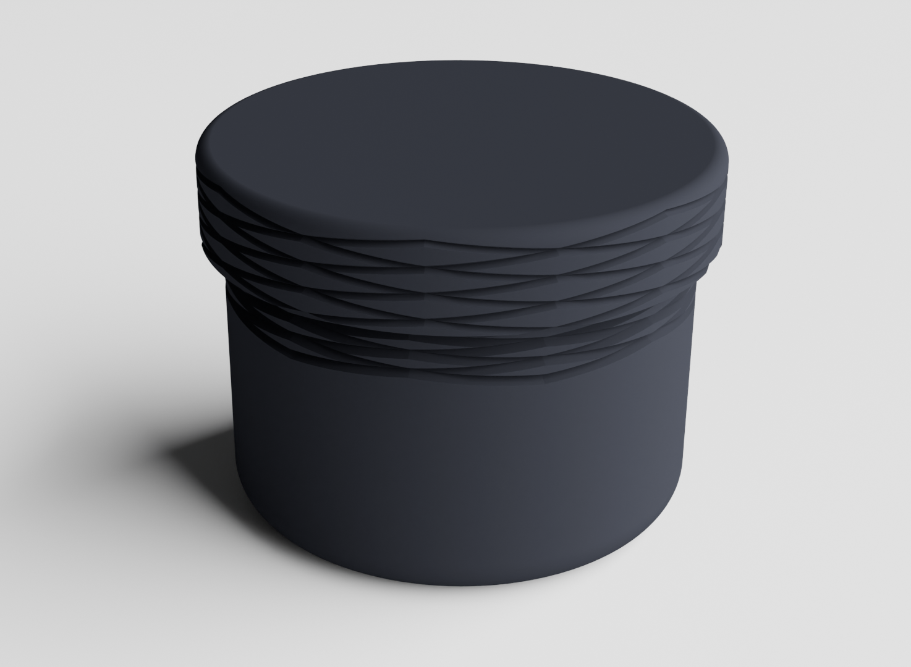
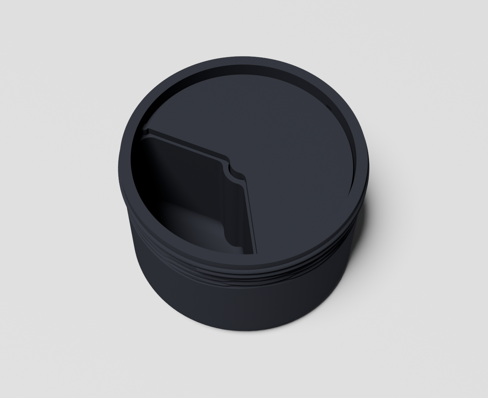
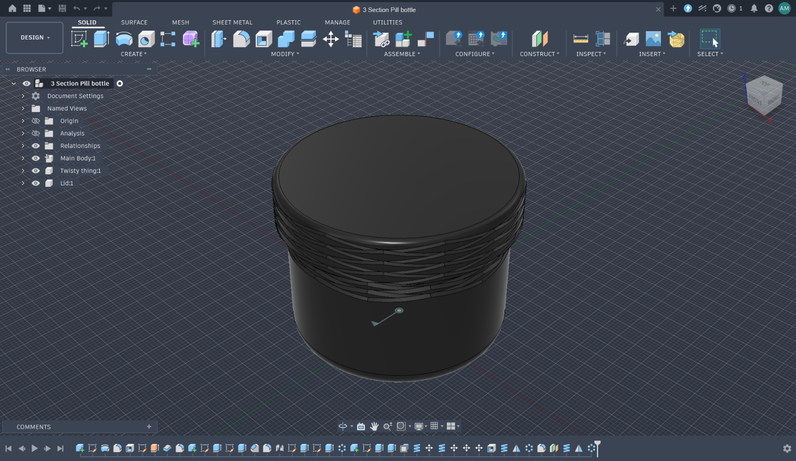

# TriMed

*Image of the full, capped container*
A simple 3D-printed medicine holder to hold three different medications. Perfect to carry basic over-the-counter medications or for your daily routinue! 

*Image of the uncapped container, exposing the internal divider*
## CAD

*Image of the CAD*
I modeled it Fusion, this was the first and last thing I ended up making anything inside Fusion. I ended up switching to Onshape right after modeling this, as that is what my robotics team uses.

## Building
### Materials
* **PLA** or other rigid filament

That's it!
### Assembly
1. Print out the parts **seperately**
2. **Insert the divider into the body.** Ensure the divider latches into the grooves inside the body.
3. **Screw on the lid**

You're done!! Yay
